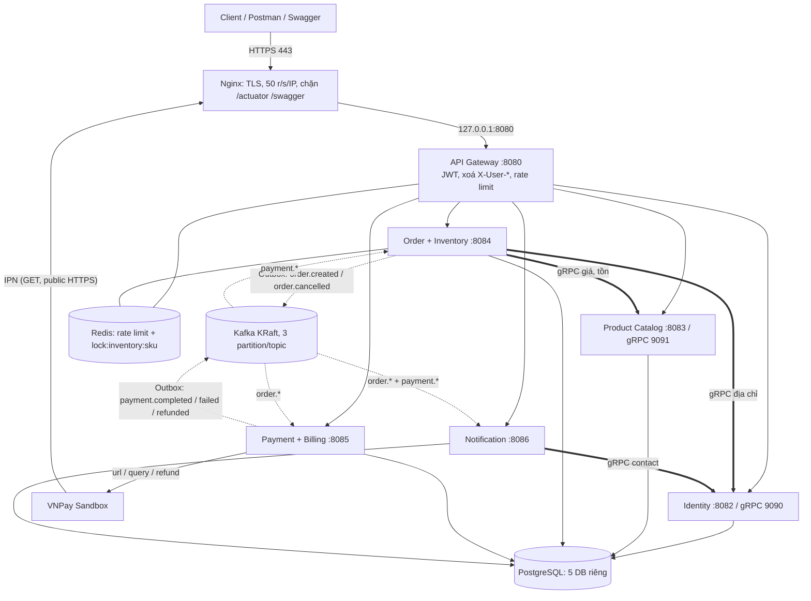

# 🚀 TỔNG QUAN & KỊCH BẢN DEMO — QuickBite Omnichannel E-Commerce

> **Tech stack**: Spring Boot 4.1.1 (Java 17) · Spring Cloud Gateway · Kafka KRaft · PostgreSQL 16 · Redis 7 · gRPC · Docker Compose · GitHub Actions → GHCR → SSH deploy · Nginx + Let's Encrypt · Prometheus · Grafana · Loki/Promtail · Jaeger (OpenTelemetry) · k6
> Domain: `https://khoatla-ecommerce.duckdns.org` · VPS 4GB RAM (103.74.101.153)
> Mọi mục dưới đây đối chiếu với source hiện tại; mục nào **chưa có bằng chứng chạy thật** thì ghi rõ "chưa verify".

---

## 1. SƠ ĐỒ KIẾN TRÚC



Thay đổi so với bản trước: topic `payment.refunded` (mới); số partition là **3** (kiểm bằng `kafka-topics.sh --describe`), không phải 1.

---

### CÁCH NÓI THEO SƠ ĐỒ (đọc từ trên xuống, ~90 giây)

> **Mở đầu:** "Đây là hệ thống bán hàng đa kênh gồm 5 microservice sau 1 API Gateway. Em chia câu chuyện làm 3 lớp: **vào hệ thống**, **xử lý đồng bộ**, **xử lý bất đồng bộ**."

1. **Client → Nginx (HTTPS 443):** "Mọi request đi qua Nginx: kết thúc TLS bằng Let's Encrypt, giới hạn 50 request/giây/IP, và chặn `/actuator`, `/swagger` — nên Internet không thấy các endpoint quản trị."
2. **Nginx → API Gateway (127.0.0.1:8080):** "Gateway là cổng duy nhất, chỉ nghe localhost. Nó kiểm JWT, **xoá các header `X-User-*` do client tự gửi** rồi gắn lại từ token — nên không ai giả danh được. Rate limit tầng 2 theo user/route lưu ở Redis."
3. **Gateway → 5 service:** "Mỗi service có DB Postgres và role riêng, không dùng chung bảng."
4. **Order → Product, Identity (mũi tên gRPC đậm):** "Lúc đặt đơn, Order cần dữ liệu **chính xác tại thời điểm đó** nên gọi **đồng bộ** gRPC: Product trả giá và tồn, Identity trả địa chỉ mặc định, deadline 3 giây. Notification cũng gọi Identity để lấy email/SĐT khách."
5. **Redis lock (cạnh Order):** "Khi giữ kho, Order khoá theo SKU bằng Redis để 2 khách không cùng giành 1 món cuối — chống oversell."
6. **Order → Kafka (nét đứt, Outbox):** "Order lưu đơn và sự kiện vào **cùng 1 transaction**, rồi một job đẩy sang Kafka. Kafka có chết thì sự kiện vẫn nằm trong DB, không mất."
7. **Kafka → Payment → VNPay:** "Payment nghe `order.created`, tạo giao dịch chờ thanh toán. Khách thanh toán ở VNPay; VNPay gọi **IPN** về Nginx → Gateway → Payment, xác minh chữ ký HMAC rồi phát `payment.completed` hoặc `payment.failed`."
8. **Kafka → Order:** "Order nghe kết quả thanh toán: thành công thì xác nhận đơn và chốt kho; thất bại thì **bù trừ** — huỷ đơn và trả kho. Đây là Saga kiểu Choreography: không có 'nhạc trưởng', mỗi service tự phản ứng với sự kiện."
9. **Kafka → Notification:** "Notification nghe tất cả sự kiện để gửi email/SMS/push. Nó là bên **bất đồng bộ thuần**: tắt Notification thì đặt hàng vẫn thành công, bật lại thì xử lý bù."
10. **Hoàn tiền:** "Admin hoàn tiền → Payment phát `payment.refunded` → Order đổi trạng thái `REFUNDED`, Notification báo khách. Kho không tự cộng vì hàng chưa chắc đã về."
11. **Chốt:** "Đồng bộ ở chỗ cần đúng ngay (giá, tồn, địa chỉ), bất đồng bộ ở chỗ chịu được trễ (thanh toán, thông báo). Sau cùng, Prometheus/Grafana/Loki/Jaeger cho em nhìn thấy toàn bộ chuỗi này."

**Câu hỏi hay gặp:** *Vì sao không gọi gRPC cho Payment?* → thanh toán là quy trình dài (khách mở VNPay), không nên giữ kết nối đồng bộ. *Nếu Kafka chết?* → Outbox giữ sự kiện, Kafka lên lại thì đẩy tiếp. *Nếu Identity chết lúc đặt đơn?* → gRPC hết deadline, API trả 502/503/504 (không tạo đơn dở).

---

## 2. NGINX
Reverse proxy `443 → 127.0.0.1:8080`, TLS (Let's Encrypt), rate limit tầng 1, chặn `/actuator|docs|swagger-ui|v3/api-docs` (trả 404), ghi đè `X-Forwarded-For` chống giả IP.
File: `infra/nginx/quickbite-limits.conf` (zone + upstream) và `infra/nginx/quickbite.conf.template` (vhost).
```nginx
limit_req_zone $binary_remote_addr zone=qb_api:10m rate=50r/s;
limit_req zone=qb_api burst=200 nodelay;   # quá burst → 503
client_max_body_size 2m;                    # >2MB → 413
```

## 3. VÌ SAO DOCKER
Môi trường đồng nhất; `docker compose up -d` dựng cả stack; `mem_limit` từng container (VPS 4GB, preset `profiles/4gb.env`); rollback bằng tag image (`:<git sha>`); build Gradle chạy trên GitHub runner, VPS chỉ `docker pull`.

## 4. DEPLOY
`push main` → GitHub Actions (build/test → docker build+push GHCR → SSH VPS: `docker compose pull` → `up -d --remove-orphans` → kiểm health). Lần đầu: `infra/scripts/setup-vps.sh` (swap, Docker, Nginx, certbot, UFW 22/80/443). Chi tiết từng bước: `DEPLOY-GUIDE.md`.

## 5. TIỀN: ÂM / TỐI THIỂU / TỐI ĐA
Dự án dùng VNPay, không có ví nội bộ. Hoàn tiền kiểm tra trong `PaymentServiceImpl.refund()`: payment phải `SUCCESS`; `amount ≤ amount_goc − refundedAmount`; VNPay nhân 100 khi gửi (`vnp_Amount`). Số âm bị chặn bởi validation của `RefundPaymentRequest`. *(Ngưỡng tối thiểu của sandbox: chưa kiểm chứng trong source, không khẳng định.)*

---

## 6. SAGA

**Happy path**
1. `POST /api/orders` → gRPC Identity (địa chỉ mặc định) + gRPC Product (giá/tồn) → reserve kho (Redis lock) → lưu Order `PENDING` + Outbox **cùng 1 transaction**.
2. Outbox → Kafka `order.created` → Payment tạo Payment `PENDING`; Notification gửi email/SMS "đặt hàng".
3. Khách gọi `POST /api/payments/order/{orderId}/vnpay-url` → thanh toán ở VNPay → IPN/Return → verify HMAC-SHA512 → Payment `SUCCESS` + Outbox `payment.completed`.
4. Order nhận → `CONFIRMED` + `commitStock()`; Notification báo thanh toán thành công.

**Thanh toán lỗi (bù trừ):** `payment.failed` → Order `CANCELLED` + `releaseStock()`; Notification báo lỗi.

**Timeout:** `SagaCompensationJob` (mỗi 5 phút) huỷ đơn `PENDING` > 30 phút, trả kho, phát `order.cancelled`.

**Hoàn tiền (MỚI — luồng chuẩn):**
```
Admin: POST /api/payments/{id}/refund  (chỉ ADMIN)
  → VNPay refund OK (responseCode 00)
  → Payment: refundedAmount += amount; đủ tiền → status REFUNDED
  → CÙNG TRANSACTION: ghi Outbox "payment.refunded"
  → Kafka payment.refunded
       ├─ Order:        CONFIRMED/SHIPPING/COMPLETED/PARTIALLY_REFUNDED → PARTIALLY_REFUNDED (hoàn 1 phần)
       │                                                                  → REFUNDED (hoàn đủ)
       │                (KHÔNG cộng kho)
       └─ Notification: email + SMS + push "đã hoàn tiền" (PAYMENT_REFUNDED)
```
Chính sách: trạng thái đơn luôn phản ánh đúng tiền; khách luôn được báo; kho chỉ cộng khi hàng thật sự về (mục 8).

## 7. KHO: RESERVE → COMMIT
| Thời điểm | available | reserved |
|---|---|---|
| Ban đầu 100 | 100 | 0 |
| Đặt 3 (PENDING) | 97 | 3 |
| Thanh toán OK (CONFIRMED) | 97 | 0 |
| Thanh toán lỗi / hết hạn (CANCELLED) | 100 | 0 |
| Hoàn tiền (REFUNDED) | **không đổi** | không đổi |

Lưu ý hành vi hiện có: **khách/admin huỷ** đơn `CONFIRMED` (`cancelOrder`) cộng lại `available` (đơn bị huỷ = hàng chưa giao). Hoàn tiền thì không.

## 8. HOÀN TIỀN & ĐỔI TRẢ
- Hoàn tiền ≠ hàng đã về kho → **không tự cộng kho** khi refund (tránh "hàng ảo").
- Khi hàng thật sự về: admin `PUT /api/inventory/{sku}/restock` (thủ công).
- Chưa có Shipment/Return service; tự động hoá luồng trả hàng là hướng phát triển.
- Trạng thái đơn: `PENDING → CONFIRMED → (SHIPPING → COMPLETED) → PARTIALLY_REFUNDED → REFUNDED`; `CANCELLED` là nhánh huỷ.
- Hoàn nhiều lần 1 phần: mỗi lần phát 1 event (khoá idempotency thông báo gồm *tổng đã hoàn*, nên không gửi trùng khi Kafka giao lặp, nhưng mỗi lần hoàn khác nhau đều được báo).

## 9. RATE LIMIT
Tầng 1 Nginx (50 r/s/IP, burst 200 → 503). Tầng 2 Gateway Token Bucket Redis (hết token → 429): login/register `LOGIN_RATE_REPLENISH=5` (burst 10); `/api/users/**` 20/s (burst 40); `/api/catalog/**` 100/s (burst 200); `/api/orders`+`/api/inventory` `ORDER_RATE_REPLENISH=100` (burst `ORDER_RATE_BURST=300`). Hai tầng **bổ sung nhau**: Nginx chặn flood theo IP trước khi vào Spring; Gateway giới hạn theo user/route.

> Demo đặt hàng / thanh toán / thông báo / hoàn tiền / Grafana / Jaeger / k6: xem **PHẦN DEMO TỪNG BƯỚC (D0–D8)** ở cuối tài liệu.

---

## 10. PHẦN KHÓ & CÁCH XỬ LÝ
1. **Outbox orderId = null** → `saveAndFlush()` trước khi dựng event.
2. **Race idempotency** → bắt `DataIntegrityViolationException`, hoàn kho request thua, trả lại đơn thắng.
3. **Consumer nuốt lỗi mất event** → bỏ try/catch, để `DefaultErrorHandler` retry; **cũng áp dụng cho `applyRefund`** (không nuốt optimistic-lock).
4. **VNPay return URL lộ dữ liệu** → bắt buộc chữ ký hợp lệ mới trả data.
5. **gRPC không deadline → cạn thread** → deadline 3s + retry 1 lần; lỗi → 502/503/504.
6. **Refund làm trạng thái đơn "nói dối" + khách không biết** → `payment.refunded` qua Outbox, Order + Notification cùng nghe.
7. **Flyway trên Spring Boot 4** → cần `spring-boot-starter-flyway` + `flyway-database-postgresql`; thiếu thì Flyway không chạy / "Unsupported Database", Hibernate validate báo thiếu bảng.


---

# PHẦN DEMO TỪNG BƯỚC (làm theo đúng thứ tự)

Quy ước: **[PC]** máy cá nhân · **[VPS]** SSH vào VPS · **[UI]** thao tác trên giao diện. Số `#n` là số thứ tự request trong Postman collection hiện có (`docs/05`), không tạo request mới.

## D0. Chuẩn bị trước giờ demo (làm 1 lần, ~15 phút)

1. **[VPS]** Stack khoẻ: `cd /opt/quickbite && docker compose ps` → tất cả `healthy`; `bash infra/scripts/verify-stack.sh`.
2. **[VPS]** Để demo tracing chắc chắn có trace: mặc định chỉ lấy mẫu 20%. Tạm tăng: `echo OTEL_SAMPLE_RATIO=1 >> .env && docker compose up -d` (tốn thêm RAM; demo xong xoá dòng này rồi `up -d`).
3. **[PC]** Mở **2 cửa sổ** (giữ nguyên, không đóng):
   - SSH tunnel monitoring: `ssh -L 3000:127.0.0.1:3000 -L 16686:127.0.0.1:16686 root@103.74.101.153`
   - SSH thường vào VPS để chạy lệnh verify (có thể dùng sẵn cửa sổ ở bước 1).
4. **[PC]** Trình duyệt mở sẵn 3 tab: Grafana `http://localhost:3000` (admin / `GRAFANA_PASSWORD` trong `.env` VPS), Jaeger `http://localhost:16686`, và Postman (collection + environment production, `baseUrl=https://khoatla-ecommerce.duckdns.org`, `adminUsername`/`adminPassword` đã nhập).
5. **[PC]** Chạy lần lượt trong Postman: **#2** đăng ký CUSTOMER → **#4** login (lưu `customerToken`, `userId`) → **#5** login ADMIN (lưu `adminToken`) → **#11** thêm địa chỉ mặc định (bắt buộc, vì Order gọi gRPC lấy địa chỉ) → **#15** tạo Brand → **#20** tạo Category → **#28** tạo Product (lưu `skuId`) → **#35** khởi tạo tồn kho. *(Nếu đã chạy `seed_data_production.sql` thì có sẵn sản phẩm/kho, nhưng vẫn cần user + địa chỉ.)*
6. Để nhận **email/SMS thật**: trong Postman đặt `realEmail`, `realPhone`, `realPhoneE164` (xem `docs/07`) và đăng ký customer bằng email/SĐT thật của bạn.

## D1. Luồng ĐẶT HÀNG (đồng bộ)

| Bước | Làm gì | Cái cần chỉ ra | Cách nói |
|---|---|---|---|
| 1 | **[PC]** Postman **#39** `POST /api/orders` (body: `idempotencyKey` = `{{$guid}}`, `customerId`, `items:[{sku, quantity:2}]`) | `201`, `status: PENDING`, có `orderCode`; ghi lại `orderId` | "Đơn tạo xong ở trạng thái chờ thanh toán; kho đã được **giữ** chứ chưa trừ hẳn." |
| 2 | **[PC]** Bấm gửi lại **đúng body đó** (cùng `idempotencyKey`) | Trả về **cùng đơn**, không tạo đơn thứ 2 | "Client retry mạng yếu cũng không đặt trùng — nhờ idempotencyKey + unique constraint." |
| 3 | **[VPS]** `docker exec postgres psql -U postgres -d order_inventory_db -c "select sku,available_qty,reserved_qty from inventories where sku='<skuId>'"` | `available` giảm 2, `reserved` tăng 2 | "Reserve: available trừ, reserved cộng. Khi thanh toán xong mới chốt." |
| 4 | **[VPS]** `docker exec postgres psql -U postgres -d order_inventory_db -c "select id,event_type,topic,status from outbox_events order by id desc limit 3"` | Có `order.created`, `status` chuyển `PENDING → PUBLISHED` sau ~1–2 giây | "Đơn và sự kiện nằm cùng 1 transaction (Outbox); job đẩy sang Kafka." |
| 5 | **[VPS]** `docker exec kafka /opt/kafka/bin/kafka-console-consumer.sh --bootstrap-server localhost:9092 --topic order.created --from-beginning --max-messages 1` | JSON sự kiện chứa `orderId`, `orderCode`, items | "Sự kiện thật trên Kafka." |
| 6 | **[VPS]** `docker exec postgres psql -U postgres -d payment_billing_db -c "select id,order_id,status,amount from payments order by id desc limit 1"` | Có Payment `PENDING` cho đơn vừa tạo | "Payment tự tạo giao dịch nhờ nghe `order.created` — Order không gọi Payment trực tiếp." |
| 7 | **[UI]** Jaeger → Service `api-gateway` → Find Traces → mở trace `POST /api/orders` | Gateway → order-inventory → 2 span gRPC (identity, product) → JDBC | "Toàn bộ hành trình 1 request, chậm ở đâu nhìn thấy ngay." |

Thử **đặt quá tồn**: dùng **#35** khởi tạo SKU tồn 1 rồi đặt `quantity: 5` → lỗi nghiệp vụ (hết hàng), kho không âm.

## D2. Luồng THANH TOÁN (VNPay Sandbox)

1. **[PC]** Postman **#44** `POST /api/payments/order/{{orderId}}/vnpay-url` (Bearer `customerToken`) → copy `data.paymentUrl`. URL hết hạn theo `expireAt`.
2. **[PC]** Mở `paymentUrl` trong trình duyệt → chọn ngân hàng **NCB** → thẻ test: số `9704198526191432198`, tên `NGUYEN VAN A`, ngày phát hành `07/15`, OTP `123456`.
3. VNPay chuyển trình duyệt về `.../api/payments/vnpay/return` (hiển thị cho khách) **và** gọi **IPN** server-to-server (nguồn xác nhận chính thức).
4. **[VPS]** Sau vài giây:
   - `docker exec postgres psql -U postgres -d payment_billing_db -c "select id,status,vnp_transaction_no,paid_at from payments order by id desc limit 1"` → `SUCCESS`
   - `docker exec postgres psql -U postgres -d order_inventory_db -c "select order_code,status from orders order by id desc limit 1"` → `CONFIRMED`
   - Kho: `reserved_qty` về 0, `available_qty` giữ nguyên (đã **chốt** trừ).
5. **[PC]** Postman: `GET /api/payments/order/{{orderId}}` và `GET /api/payments/{{paymentId}}/logs` → thấy log `CREATE_PAYMENT_URL`, `RETURN_URL`/`IPN_CALLBACK`.
6. **Thanh toán lỗi (để chỉ Saga bù trừ):** tạo đơn mới → mở URL → bấm **Huỷ** ở trang VNPay → đơn `CANCELLED`, kho **được trả lại** (`available` tăng lại).
> Cách nói: "Order không biết VNPay. Payment xác minh chữ ký rồi phát sự kiện; Order tự quyết định xác nhận hay bù trừ."

## D3. Luồng THÔNG BÁO

1. **Thông báo thật:** sau D2 bước 4, kiểm tra hộp thư (`realEmail`) và điện thoại (`realPhone`) — nhận email/SMS *thanh toán thành công* (và *đặt hàng*).
2. **[PC]** Postman (ADMIN, `adminToken`): `GET /api/notifications/logs?orderId={{orderId}}` → các dòng `ORDER_CREATED`, `PAYMENT_COMPLETED` × kênh `EMAIL/SMS/PUSH`, `status: SENT`.
3. **[VPS]** `docker exec postgres psql -U postgres -d notification_db -c "select notification_type,channel,status,recipient from notification_logs where order_id=<orderId> order by id"`.
4. **Chứng minh bất đồng bộ (đáng demo nhất):**
   - **[VPS]** `docker stop notification-service`
   - **[PC]** Tạo đơn mới (#39) → vẫn `201` thành công.
   - **[VPS]** `docker start notification-service` → đợi healthy (~1–2 phút) → chạy lại lệnh ở bước 3 cho đơn mới: thông báo xuất hiện **bù** (Kafka giữ offset).
   > "Notification chết không làm hỏng đặt hàng; sự kiện nằm chờ trên Kafka."
5. Gửi thử thủ công: `POST /api/notifications/test` (body: `channel`, `recipient`, `subject`, `body`).

## D4. HOÀN TIỀN (luồng chuẩn mới)
1. **[PC]** Postman (ADMIN): `POST /api/payments/{{paymentId}}/refund` body `{"amount": <số tiền>, "reason": "Khach tra hang", "createBy": "admin"}` (payment phải `SUCCESS`; sandbox có thể từ chối — ghi nguyên mã trả về).
2. **[VPS]** `select topic,status from outbox_events where topic='payment.refunded' order by id desc limit 1` (payment_billing_db) → `PUBLISHED`.
3. Vài giây sau: đơn → `REFUNDED` (hoàn đủ) / `PARTIALLY_REFUNDED`; `GET /api/notifications/logs?orderId=...` có `PAYMENT_REFUNDED`; kho **không đổi**.
> "Trạng thái đơn luôn đúng với tiền, khách luôn được báo, kho tách riêng theo chính sách trả hàng."

## D5. GRAFANA (metrics + logs)

**[UI]** `http://localhost:3000` → Dashboards → **QuickBite — Overview**. Có 7 panel (đúng như source):

| Panel | Nhìn gì | Khi nào thấy rõ |
|---|---|---|
| Service UP | 6 service = 1 | Luôn |
| HTTP request rate (req/s) | Cột/đường của `api-gateway`, `order-inventory-service` tăng khi tạo đơn/chạy k6 | Khi đặt hàng liên tục |
| Latency TB (s) | Độ trễ trung bình theo service | Chạy k6 |
| JVM heap used | Heap từng JVM; không tăng vô hạn | Chạy k6 |
| CPU process (%) | CPU từng service | Chạy k6 |
| HikariCP connections active | Kết nối DB đang dùng | Chạy k6 |
| Kafka consumer lag (max) | Về 0 = consumer theo kịp | Sau mỗi đợt tải |

Thao tác: đặt time range **Last 15 minutes**, auto-refresh **10s** → chạy D1 vài lần (hoặc k6 ở D7) → chỉ vào panel request rate nhích lên.
**Logs (Loki):** Grafana → Explore → datasource **Loki** → chạy:
- `{container="order-inventory-service"}` rồi thêm `|= "orderCode"` hoặc `|= "payment.completed"`;
- `{container="payment-billing-service"} |= "IPN"`;
- `{container="notification-service"} |= "payment.refunded"`.
Nhãn `container` là tên container (xem danh sách: Explore → Label browser → `container`). Trước khi demo hãy kiểm tra các nhãn này có thật trên máy bạn.
**Prometheus:** không public. Kiểm tra scrape: **[VPS]** `docker exec prometheus wget -qO- http://localhost:9090/api/v1/targets | grep -o '"health":"[a-z]*"' | sort | uniq -c` → 7 `up`.
> Cách nói: "Metrics trả lời *hệ thống có khoẻ không*, log trả lời *chuyện gì đã xảy ra*, trace trả lời *chậm ở đâu*."

## D6. TRACING (Jaeger + OpenTelemetry) — xem TẤT CẢ loại span

OpenTelemetry Java agent được gắn vào JVM của 6 service (`monitoring/docker-compose.tracing.yml`), gửi OTLP gRPC → Jaeger `:4317`; không sửa code nghiệp vụ. **[UI]** `http://localhost:16686`.

1. **Danh sách service:** dropdown *Service* phải có 6 mục: `api-gateway`, `identity-user-service`, `product-catalog-service`, `order-inventory-service`, `payment-billing-service`, `notification-service`. Thiếu cái nào ⇒ service đó chưa gắn agent/chưa có traffic.
2. **Trace đặt hàng (đồng bộ):** Service `api-gateway` → Lookback *Last 15 Minutes* → Find Traces → mở trace `POST /api/orders`. Đọc từ trên xuống: gateway → order-inventory-service → 2 span **gRPC** (sang identity và product) → span **JDBC** (insert order, outbox) → có thể có span **Redis** (lock kho).
3. **Lọc theo loại span** (ô *Tags*; nếu tag không ra kết quả, bỏ Tags và lọc bằng Operation):
   - gRPC: `rpc.system=grpc`
   - Database: `db.system=postgresql`
   - Redis: `db.system=redis`
   - Kafka: `messaging.system=kafka`
4. **Trace bất đồng bộ (trace riêng):** Service `order-inventory-service` → chọn operation của Outbox publisher; rồi Service `payment-billing-service` → span consume `order.created` → JDBC insert payment. Các trace này được **liên kết** qua header Kafka (hiển thị dạng *follows from*), không nằm chung 1 cây với `POST /api/orders` — đó là hành vi đúng của luồng bất đồng bộ.
5. **Trace thanh toán:** Service `payment-billing-service` → span request IPN (`GET /api/payments/vnpay/ipn`) → JDBC update + insert outbox.
6. **So sánh:** chọn 2 trace → *Compare* để chỉ trace nhanh vs chậm.
> Lưu ý trung thực: chỉ có trace khi **sample** (mặc định 20%, đã đặt 100% ở D0.2). Span nào hiện ra phụ thuộc agent; nếu một loại (ví dụ Kafka) không thấy, ghi rõ "chưa thấy", đừng khẳng định. Kết luận OpenTelemetry chỉ PASS khi Jaeger hiện trace thật (xem `docs/08` A8).

## D7. K6 (load test, chạy từ máy cá nhân)

**Trước khi chạy**
1. **[PC]** Cài k6: `winget install k6` → mở PowerShell mới → `k6 version`. Đặt biến: `$env:BASE="https://khoatla-ecommerce.duckdns.org"; $env:PW="<ADMIN_DEFAULT_PASSWORD trong .env VPS>"`.
2. **[VPS]** `cd /opt/quickbite && bash infra/scripts/loadtest-mode.sh on` (nới rate limit để 1 IP không bị 429). **Bắt buộc `off` sau khi xong.**
3. **[VPS]** (cửa sổ SSH thứ 2) theo dõi: `watch -n 5 "docker stats --no-stream --format 'table {{.Name}}\t{{.MemPerc}}\t{{.CPUPerc}}'; free -m | head -3"`. **[UI]** Mở Grafana (D5) time range *Last 15 minutes*, refresh 5s.

**Chạy (tăng dần, nghỉ 2 phút giữa các mức)**
```powershell
# 1) Smoke — chỉ để xác nhận chức năng
k6 run -e BASE_URL=$env:BASE -e ADMIN_PASSWORD=$env:PW -e SCENARIO=smoke -e STOCK=100 load-test\k6-production-load-test.js
# 2) Tăng tải theo năng lực VPS (RATE = số request /api/orders mỗi giây ở mức ổn định)
k6 run -e BASE_URL=$env:BASE -e ADMIN_PASSWORD=$env:PW -e SCENARIO=custom -e RATE=10  -e HOLD=60s -e STOCK=100 load-test\k6-production-load-test.js
k6 run -e BASE_URL=$env:BASE -e ADMIN_PASSWORD=$env:PW -e SCENARIO=custom -e RATE=25  -e HOLD=60s -e STOCK=100 load-test\k6-production-load-test.js
k6 run -e BASE_URL=$env:BASE -e ADMIN_PASSWORD=$env:PW -e SCENARIO=custom -e RATE=50  -e HOLD=60s -e STOCK=100 load-test\k6-production-load-test.js
```
Dừng tăng khi: p95 > 3s, 5xx > 1%, `dropped_iterations` lớn, container OOMKilled/restart, hoặc `free -m` available < 150 MB. Mức cao nhất vẫn sạch = **năng lực đo được** của VPS này.

**Đọc kết quả k6:** `http_reqs` (rate = RPS thực) · `http_req_duration` p(95)/p(99) · `orders_created` (đơn thành công) · `orders_sold_out` (400/409 = hết hàng, **hợp lệ**) · `orders_rate_limited` (429) · `orders_error_5xx`. Dòng cuối in `FLASH-xxxx` = SKU của lượt chạy.

**Sau mỗi mức [VPS] (kiểm tra không oversell)** — thay `FLASH-xxxx`:
```bash
docker exec postgres psql -U postgres -d order_inventory_db -c "select sku,available_qty,reserved_qty,(available_qty+reserved_qty) total from inventories where sku='FLASH-xxxx'"   # total = STOCK, available >= 0
docker exec postgres psql -U postgres -d order_inventory_db -c "select status,count(*) from orders group by status"
docker exec postgres psql -U postgres -d order_inventory_db -c "select status,count(*) from outbox_events group by status"   # PENDING về 0
docker exec kafka /opt/kafka/bin/kafka-consumer-groups.sh --bootstrap-server localhost:9092 --describe --all-groups          # LAG về 0
docker inspect -f '{{.Name}} OOM={{.State.OOMKilled}} restarts={{.RestartCount}}' $(docker ps -q)
```
Quy tắc đạt: `orders_created` = `STOCK − available_qty`; `available_qty ≥ 0`; `available+reserved = STOCK`.

**Trong lúc chạy, chỉ trên Grafana:** request rate của `api-gateway`/`order-inventory-service` tăng, latency/heap/CPU nhích lên, HikariCP active tăng, Kafka lag tăng rồi về 0. **Trên Jaeger:** lọc trace `POST /api/orders` có thời gian dài nhất để chỉ nút cổ chai.

**Dọn dẹp [VPS]:** `bash infra/scripts/loadtest-mode.sh off`; nếu đã đặt `OTEL_SAMPLE_RATIO=1` ở D0.2 thì xoá dòng đó khỏi `.env` rồi `docker compose up -d`.

**Kết luận (2 dòng riêng, theo số đo thật):** *PASS FUNCTIONAL* khi không oversell + số đơn khớp + Outbox/Kafka đuổi kịp + không OOM. *Load theo đề 500–1000 req/s:* ghi KHÔNG TEST/FAIL nếu không đạt; báo cáo "ổn định tới N req/s, p95 = X ms" bằng số đo thật. Bảng điền kết quả: `docs/08` mục B5.

## D8. KỊCH BẢN 10 PHÚT (tóm tắt)
1. (1′) Nói theo sơ đồ. 2. (2′) D1 đặt hàng + idempotency + Outbox/Kafka. 3. (2′) D2 thanh toán VNPay thẻ test → đơn CONFIRMED. 4. (1′) D3 nhận email/SMS thật + tắt/bật Notification. 5. (1′) D4 hoàn tiền → REFUNDED. 6. (1.5′) D5 Grafana + Loki. 7. (1.5′) D6 Jaeger waterfall. 8. (1′) D7 mở kết quả k6 đã chạy sẵn (đừng chạy live nếu VPS yếu) và nêu kết luận trung thực.

---
*Cập nhật: 2026-10-14. Chưa có bằng chứng chạy thật cho: refund → REFUNDED end-to-end, monitoring/tracing, load test (chờ log từ VPS).*