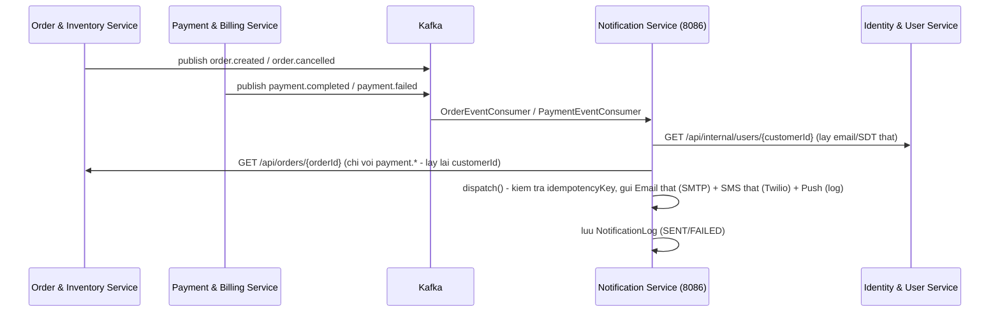

# Notification Service — Kết quả Verify & Hướng dẫn Test

## 1. Kết quả verify

Code có sẵn đã khá tốt (đúng contract Kafka 1:1 với `order-inventory-service`/`payment-billing-service`,
đã tích hợp THẬT với `identity-user-service` qua `/api/internal/users/{id}`, dùng Strategy Pattern
cho Email/SMS/Push). Đã bổ sung/sửa để **đồng bộ 100%** với 2 service kia:

| # | File | Vấn đề | Đã sửa |
|---|---|---|---|
| 1 | `dto/response/ApiResponse.java` | Thiếu 2 static factory `created()` / `error()` mà `order-inventory-service` có → `GlobalExceptionHandler` không thể dùng `ApiResponse.error(...)` thống nhất. | Thêm 2 method, khớp 100% với bản của `order-inventory-service`. |
| 2 | `exception/GlobalExceptionHandler.java` | Bản cũ chỉ xử lý 4 exception (thiếu `MethodArgumentNotValidException`, `HttpMessageNotReadableException`, `MethodArgumentTypeMismatchException`, `BindException`, `ConflictException`, `DataIntegrityViolationException`, `ObjectOptimisticLockingFailureException`) → request sai định dạng (`?notificationType=ABC` không hợp lệ) sẽ rơi vào handler `Exception` chung, trả lỗi 500 mù mờ thay vì 400 rõ ràng. | Viết lại đầy đủ, đồng bộ với `order-inventory-service`, tuỳ biến thông báo lỗi cho `NotificationType`/`NotificationChannel`/`NotificationStatus`. |
| 3 | `exception/ConflictException.java` | Thiếu (có ở 2 service kia). | Thêm mới cho đồng bộ bộ exception dùng chung. |
| 4 | `service/impl/NotificationServiceImpl.java` | 4 method `handleOrderCreated/handleOrderCancelled/handlePaymentCompleted/handlePaymentFailed` đánh `@Transactional` bao trọn cả cuộc gọi **SMTP thật** + **REST sang Identity/Order Service** → giữ connection DB mở suốt thời gian chờ mạng phản hồi, dễ cạn connection pool khi tải cao. | Bỏ `@Transactional` ở 4 method này (các lệnh đọc/ghi trong `dispatch()` vẫn tự có transaction riêng theo cơ chế mặc định của Spring Data JPA — không mất tính toàn vẹn). |
| 5 | `application.yml` | `spring.mail.username/password` để trống, `notification.mail-enabled=false` mặc định → không gửi email thật được. | Đã điền thông tin SMTP Gmail thật bạn cung cấp, bật `mail-enabled=true` mặc định. **Xem cảnh báo bảo mật bên dưới.** |
| 6 | `service/impl/LoggingSmsSender.java` | Chỉ ghi log, không gửi SMS thật. | Thay bằng `TwilioSmsSender` (gọi Twilio Programmable Messaging API thật khi `notification.sms-enabled=true`), tự chuẩn hoá số điện thoại VN sang định dạng E.164. Đã điền sẵn Account SID/Auth Token/From Number thật bạn cung cấp, `sms-enabled=true` mặc định. |
| 7 | `controller/InternalUserController.java` (`identity-user-service`) | Sai API key trả về `400 Bad Request` (`BadRequestException`) — không đúng ngữ nghĩa HTTP (đây là lỗi *quyền truy cập*, không phải *dữ liệu sai*). | Đổi sang `ForbiddenException` có sẵn trong project → trả `403 Forbidden`. |
| 8 | `exception/GlobalExceptionHandler.java` | `ex.printStackTrace()` ở handler `Exception` chung — không dùng logger chuẩn (SLF4J) như 2 service kia. | Thêm `@Slf4j`, đổi thành `log.error(...)`. |
| 9 | `service/impl/NotificationServiceImpl.java` | `handleOrderCreated`/`handleOrderCancelled` gọi `templateService.xxx(event)` **2 lần** cho cùng 1 nội dung (1 lần để log DB, 1 lần trong lambda gửi thật) — dư thừa, không sạch. | Tính `subject`/`body`/`smsBody`/`pushTitle`/`pushBody` **1 lần** thành biến local, tái dùng cho cả `dispatch()` lẫn lambda gửi. |
| 10 | `handlePaymentCompleted`/`handlePaymentFailed` | Chỉ gửi Email + SMS, **thiếu kênh Push** so với `handleOrderCreated`/`handleOrderCancelled` (không đồng nhất, và đề bài yêu cầu Push cho "cập nhật trạng thái đơn hàng" nói chung). | Thêm dispatch kênh `PUSH` cho cả 2 method, thêm 4 method template mới (`paymentCompletedPushTitle/Body`, `paymentFailedPushTitle/Body`) vào `NotificationTemplateService`. |
| 11 | `order-inventory-service`, `product-catalog-service`, `identity-user-service` — `build.gradle` | Bạn đã tick **Cloud LoadBalancer** trên Spring Initializr cho cả 3 service này nhưng `build.gradle` không có → do bạn bấm **Add** (merge vào project) thay vì tạo project mới nên Initializr chỉ hiển thị UI, chưa thật sự ghi dependency vào file. | Thêm `spring-cloud-starter-loadbalancer` vào cả 3 file, kèm comment giải thích: cả 3 service này **hiện chưa thực sự cần** nó (chưa có `@LoadBalanced RestTemplate`/`RestClient` nào gọi sang service khác qua tên Eureka — Order gọi Product bằng gRPC địa chỉ tĩnh, Product/Identity chỉ bị gọi vào chứ không tự gọi ra), nhưng vẫn thêm để khớp lựa chọn của bạn và sẵn sàng cho sau này. Ngược lại, `notification-service` **bắt buộc phải có** dependency này vì `RestClientConfig` dùng `@LoadBalanced RestTemplate` để gọi `identity-user-service`/`order-inventory-service` qua tên service. |

Các phần còn lại (package structure, DTO riêng, interface Service, contract Kafka, tích hợp
Identity Service, Strategy Pattern cho Email/SMS/Push, idempotency theo `idempotencyKey`) **đã đúng
chuẩn, giữ nguyên**.

### ⚠️ Cảnh báo bảo mật quan trọng
App Password Gmail (da lo trong source cu - phai THU HOI) và Twilio Account SID/Auth Token bạn gửi giờ đã nằm
trong `application.yml` làm giá trị mặc định — dùng được ngay, không cần cấu hình gì thêm để demo.
Nhưng vì đề bài yêu cầu push code lên GitHub (CI/CD): nếu repo là **public**, bất kỳ ai cũng đọc
được các credential này. Trước khi push / nộp bài:
1. Xoá phần `:gia-tri-mac-dinh` sau mỗi biến trong `application.yml` (`${MAIL_USERNAME:...}` →
   `${MAIL_USERNAME}`, tương tự cho `MAIL_PASSWORD`/`TWILIO_ACCOUNT_SID`/`TWILIO_AUTH_TOKEN`/
   `TWILIO_FROM_NUMBER`) và chỉ truyền giá trị thật qua biến môi trường lúc chạy (`export ...`,
   `.env` không commit, hoặc GitHub Actions Secrets khi deploy CI/CD).
2. Vào **https://myaccount.google.com/apppasswords** thu hồi App Password này, tạo App Password mới.
3. Vào **console.twilio.com → Account → API keys & tokens** bấm **Regenerate** để đổi Auth Token mới
   (Account SID thì không đổi được nhưng không nhạy cảm bằng Auth Token — Auth Token mới mới là thứ
   cần thu hồi).

### Vì sao dùng PostgreSQL thay vì MongoDB/Redis như đề gợi ý?
Đề bài gợi ý `Redis (Queue) hoặc MongoDB` cho Notification Service, nhưng `product-catalog-service`
trong cùng project này cũng đã chọn PostgreSQL thay vì MongoDB+Elasticsearch như đề gợi ý — để
**đồng bộ 1 loại database duy nhất** cho toàn bộ stack, giảm độ phức tạp hạ tầng (không phải cài
thêm MongoDB chỉ để lưu vài dòng log). Đây là đánh đổi kỹ thuật hợp lý, hãy nêu rõ điều này khi
báo cáo/thuyết trình đồ án (phần "giải thích lựa chọn công nghệ" thường được đánh giá cao khi có lý
do rõ ràng thay vì làm sai lệch một cách vô tình).

---

## 2. Kiến trúc package

```
com.quickbite.edu
├── NotificationServiceApplication.java
├── config/ (NotificationProperties, OpenApiConfig, RestClientConfig - RestTemplate @LoadBalanced)
├── controller/NotificationLogController.java      # /api/notifications/logs/** (chi doc, tra cuu)
├── dto/
│   ├── ValidationError.java
│   ├── client/UserContactResponse.java            # DTO nhan tu Identity Service
│   └── response/ (ApiResponse, PageResponse, NotificationLogResponse, OrderSummaryResponse)
├── entity/
│   ├── NotificationLog.java
│   └── enums/ (NotificationChannel, NotificationStatus, NotificationType)
├── event/       # OrderCreatedEvent, OrderItemEvent, OrderCancelledEvent, PaymentResultEvent
│                # (khop 1:1 voi order-inventory-service / payment-billing-service)
├── exception/   # BadRequestException, NotFoundException, ConflictException, GlobalExceptionHandler
├── kafka/
│   ├── KafkaTopics.java
│   ├── OrderEventConsumer.java     # nghe order.created, order.cancelled
│   └── PaymentEventConsumer.java   # nghe payment.completed, payment.failed
├── mapper/NotificationMapper.java
├── repository/NotificationLogRepository.java
└── service/
    ├── interfaces/ (NotificationService, NotificationTemplateService, EmailSender,
    │                SmsSender, PushNotificationSender, UserContactService)
    └── impl/
        ├── NotificationServiceImpl.java       # dieu phoi chinh: nhan event -> dispatch 3 kenh
        ├── NotificationTemplateServiceImpl.java # sinh noi dung Email/SMS/Push (template)
        ├── LoggingEmailSender.java             # gui EMAIL THAT qua SMTP (JavaMailSender)
        ├── TwilioSmsSender.java                # gui SMS THAT qua Twilio (fallback log neu sms-enabled=false)
        ├── LoggingPushNotificationSender.java  # mo phong (log) - FCM can Firebase project rieng
        ├── UserContactServiceImpl.java         # goi Identity Service lay email/SDT that
        └── OrderLookupService.java             # goi Order Service lay customerId tu orderId
                                                 # (PaymentResultEvent khong mang san customerId)
```

Notification Service là **leaf consumer thuần** trong sơ đồ kiến trúc (đề bài mục 2.2: `MQ ->
Consume Event -> Notification Service`, không có mũi tên đi ra) — vì vậy KHÔNG cần Kafka Producer,
KHÔNG cần Outbox Pattern (không publish gì cả), và KHÔNG có endpoint tạo/sửa dữ liệu nghiệp vụ,
chỉ có API tra cứu lịch sử gửi tin (`GET /api/notifications/logs`).

### Vì sao Push vẫn chỉ "mô phỏng" (ghi log) còn Email/SMS gửi thật?
Email (SMTP Gmail) và SMS (Twilio Trial) đều dùng được miễn phí ở mức demo với tài khoản bạn đã
cung cấp. Push thật (Firebase Cloud Messaging) thì **bắt buộc phải tạo riêng 1 Firebase project +
app key** cho đúng app di động/web cụ thể của bạn (không có credential dùng chung kiểu SMTP/Twilio) —
ngoài phạm vi 1 backend service có thể tự cấu hình sẵn. `LoggingPushNotificationSender` ghi log
console + lưu `NotificationLog` với `status=SENT` giống hệt luồng thật; khi nào có Firebase project
thật, chỉ cần viết 1 implementation mới của `PushNotificationSender` (interface đã tách sẵn theo
Strategy Pattern, không cần sửa gì ở `NotificationServiceImpl`).

### Twilio SMS — lưu ý tài khoản Trial (miễn phí)
Tài khoản Twilio Trial **chỉ gửi được SMS tới các số đã "Verify"** thủ công trong Console
(**Phone Numbers → Verified Caller IDs → Add a new number**) — giới hạn của Twilio, không phải lỗi
code; gửi tới số chưa verify sẽ bị từ chối (lỗi 21608/21211). Mỗi SMS gửi từ tài khoản Trial cũng sẽ
tự động bị Twilio chèn thêm tiền tố `"Sent from your Twilio trial account - "` vào đầu nội dung.
Muốn gửi tới số bất kỳ không cần verify trước, cần nâng cấp tài khoản Twilio lên trả phí.

---

## 3. Luồng nghiệp vụ



---

## 4. Hướng dẫn test Postman

### 4.1. Test tra cứu lịch sử (API đọc, dùng Postman bình thường)
```
GET http://localhost:8086/api/notifications/logs?page=0&size=20
GET http://localhost:8086/api/notifications/logs?customerId=501
GET http://localhost:8086/api/notifications/logs?orderId=1001
GET http://localhost:8086/api/notifications/logs?notificationType=ORDER_CREATED
GET http://localhost:8086/api/notifications/logs/{id}
```

### 4.2. Test luồng gửi thông báo thật — bắn message giả lên Kafka
Notification Service không có endpoint "tạo" (đúng kiến trúc leaf consumer), nên test độc lập bằng
`kafka-console-producer` (giống cách đã hướng dẫn cho `payment-billing-service`):

```bash
# 1) order.created -> gui EMAIL that (kiem tra hop thu cua email dung lam "khach hang" test)
#    + SMS/Push mo phong (xem log console)
echo '{"orderId":1001,"orderCode":"ORD-1001","customerId":1,"totalAmount":150000,"shippingAddress":"123 Nguyen Trai, Q5","items":[{"sku":"SKU001","productName":"Ao thun","unitPrice":150000,"quantity":1}]}' | \
  kafka-console-producer.sh --broker-list localhost:9092 --topic order.created

# 2) order.cancelled
echo '{"orderId":1001,"orderCode":"ORD-1001","customerId":1,"reason":"Het hang"}' | \
  kafka-console-producer.sh --broker-list localhost:9092 --topic order.cancelled

# 3) payment.completed (khong co customerId san -> Notification tu goi Order Service de lay lai;
#    neu Order Service chua chay se fallback ve email demo, van gui duoc, khong loi)
echo '{"orderId":1001,"orderCode":"ORD-1001","transactionId":"VNP123456"}' | \
  kafka-console-producer.sh --broker-list localhost:9092 --topic payment.completed

# 4) payment.failed
echo '{"orderId":1001,"orderCode":"ORD-1001","reason":"Khach huy giao dich tren VNPay"}' | \
  kafka-console-producer.sh --broker-list localhost:9092 --topic payment.failed
```
(Nếu Kafka chạy trong Docker: `docker exec -i <container_kafka> kafka-console-producer.sh ...`)

Sau mỗi lệnh trên, gọi lại **4.1** để kiểm tra `NotificationLog` mới được ghi, `status=SENT`, và
kiểm tra thật hộp thư email của `customerId=1` (nếu `customerId=1` tồn tại thật trong
`identity-user-service` thì email THẬT sẽ được gửi tới địa chỉ đã đăng ký; nếu Identity Service
chưa chạy hoặc `customerId` không tồn tại, hệ thống tự fallback về
`customer1@quickbite.local` và **KHÔNG báo lỗi** — vẫn ghi log với `status=SENT` vì hàm gửi email
chỉ throw lỗi khi SMTP thật sự thất bại, không phải vì địa chỉ giả).

> Test SMS thật: số điện thoại của `customerId` dùng để test phải là số **đã Verify** trong Twilio
> Console (xem mục "Twilio SMS" ở trên), nếu không SMS sẽ ghi `NotificationLog.status=FAILED` với
> `errorMessage` chứa lỗi Twilio (21608/21211) — Email vẫn gửi bình thường vì không bị giới hạn này.

> Test idempotency: bắn lại **đúng y hệt** message `order.created` ở bước 1 lần thứ 2 → log server
> in ra `"Bo qua notification trung (idempotent)"`, không gửi email lần 2, không tạo thêm
> `NotificationLog` mới (khớp `idempotencyKey = notificationType:orderId:channel`).

### 4.3. Test full Saga thật (khuyến nghị nếu có thời gian)
Chạy đủ Eureka + Kafka + Postgres + `identity-user-service` + `product-catalog-service` +
`order-inventory-service` + `payment-billing-service` + `notification-service`. Tạo tài khoản thật
qua `POST /api/users/register` (Identity Service) với email của chính bạn, tạo đơn hàng, thanh toán
qua VNPay Sandbox (xem README của `payment-billing-service`) → Notification Service sẽ tự gửi email
thật tới đúng địa chỉ bạn đăng ký ở từng bước (đặt hàng, huỷ đơn, thanh toán thành công/thất bại).

### 4.4. Demo tính sẵn sàng (đề bài mục 5.4)
Tắt `notification-service` khi Order/Payment Service vẫn chạy: đặt hàng và thanh toán vẫn thành
công bình thường (không có lệnh gọi đồng bộ nào tới Notification Service). Khi bật lại
`notification-service`, Kafka consumer group `notification-service` tự đọc bù các message
`order.created`/`payment.completed`... còn tồn đọng trong topic — không mất thông báo cần gửi.

---

## 5. Audit lần 2 (theo checklist 7 bước: Đọc code → Đọc đề → Audit bảng → Đối chiếu 3 service → Liệt kê lỗi → Sửa → Review lại)

### 5.1. Kết quả đối chiếu Kafka contract (diff từng field với order-inventory-service/payment-billing-service)
`OrderCreatedEvent`, `OrderItemEvent`, `OrderCancelledEvent`, `PaymentResultEvent`, `KafkaTopics`
**khớp 100%** (chỉ khác Javadoc, field/topic giống hệt). Đã verify `identity-user-service` có đúng
endpoint `/api/internal/users/{id}` (header `X-Internal-Api-Key`, response `ApiResponse<UserContactResponse>`
với đúng 5 field `id/username/email/fullName/phone`) và `order-inventory-service` có đúng
`GET /api/orders/{id}` trả `ApiResponse<OrderResponse>` với field `customerId` — cả 2 đều **không có
Security chặn** nên `@LoadBalanced RestTemplate` gọi được bình thường qua Eureka.

### 5.2. Lỗi phát hiện & đã sửa

| # | Mức độ | Vấn đề | Đã sửa |
|---|---|---|---|
| 1 | **HIGH** | `dispatch()` theo thứ tự "kiểm tra idempotency → gửi thật → mới lưu log" — **không atomic**. Nếu 2 luồng xử lý trùng 1 event (Kafka redeliver), cả 2 có thể cùng vượt qua bước kiểm tra trước khi bên nào kịp lưu log, dẫn đến **gửi thật 2 lần** (email/SMS) dù DB chỉ giữ được 1 dòng nhờ unique constraint. | Đảo thứ tự: **INSERT placeholder `PENDING` trước** (unique constraint trên `idempotency_key` chặn ngay ở bước ghi DB, atomic ở mức index) → chỉ luồng insert thành công mới được đi tiếp gọi `sendAction.run()` → sau đó `UPDATE` lại thành `SENT/FAILED`. |
| 2 | **MEDIUM** | `management.endpoints.web.exposure.include` có `prometheus` nhưng **thiếu dependency** `micrometer-registry-prometheus` → endpoint không hoạt động dù khai báo, không đúng yêu cầu Monitoring (mục 4.6 đề bài). | Thêm `implementation 'io.micrometer:micrometer-registry-prometheus'` vào `build.gradle`. |
| 3 | **MEDIUM** | Twilio SDK kéo theo Jackson 2.x classic transitively, trong khi project dùng Jackson 3 (`tools.jackson.*`) — 2 phiên bản Jackson cùng lúc trên classpath, rủi ro tiềm ẩn khi Spring auto-config message converter. | Loại trừ (`exclude`) `jackson-databind/jackson-core/jackson-annotations` khỏi dependency Twilio trong `build.gradle`. |
| 4 | **MEDIUM** | `src/test/resources/application.yml` bật Flyway chạy migration thuần cú pháp PostgreSQL (`BIGSERIAL`) trên H2 → rủi ro context-load test fail tùy phiên bản H2. | Tắt Flyway trong profile test, dùng `hibernate.ddl-auto: create-drop` để Hibernate tự sinh schema từ Entity trên H2 (Flyway vẫn là nguồn schema duy nhất khi chạy thật với PostgreSQL). Đồng thời tắt `sms-enabled` trong test để tránh Twilio SDK cố init lúc context load. |
| 5 | **MEDIUM** | Không có cách nào gửi thử 1 thông báo thật qua Postman mà không cần dựng cả chain Kafka + Order + Payment Service → khó demo/chấm nhanh. | Thêm `POST /api/notifications/test` (có `@Valid` — dùng luôn `spring-boot-starter-validation` vốn đã khai báo nhưng chưa dùng ở đâu) + `NotificationType.MANUAL_TEST` + endpoint đã có trong Postman collection. |
| 6 | **LOW** | `search()` chỉ lọc được `customerId/orderId/notificationType`, thiếu `channel`/`status`. | Chuyển sang **Spring Data JPA Specification** (`NotificationLogSpecifications` + `JpaSpecificationExecutor`) — lọc được bất kỳ tổ hợp nào trong 5 field mà không cần viết `findByXAndYAndZ...` (tránh bùng nổ tổ hợp 2⁵ method nếu làm theo kiểu cũ). |
| 7 | **CRITICAL (toàn dự án)** | Thiếu hoàn toàn Dockerfile, docker-compose, Postman collection theo đúng yêu cầu triển khai VPS (mục 4 đề bài). | Thêm `Dockerfile` (multi-stage build, non-root user, HEALTHCHECK), `docker-compose.snippet.yml` (kèm giải thích vì sao dùng chung port Postgres 5433 với identity/payment service), `postman/Notification-Service.postman_collection.json` (10 request, gồm cả case lỗi validation để test `GlobalExceptionHandler`). |

### 5.3. Review lại code vừa sửa (bước 7)
- Đã chạy script kiểm tra cân bằng ngoặc `{}`/`()` cho **toàn bộ** file `.java` trong service — **OK, không lệch ngoặc ở file nào**.
- Đã `grep` xác nhận không còn tham chiếu nào tới các method Repository cũ đã xoá (`findByCustomerId`, `findByOrderId`, `findByNotificationType`, `findByCustomerIdAndOrderId`) — không có circular reference, không có method mồ côi.
- Đã đối chiếu từng field trong `NotificationLog.builder()...` (cả ở `dispatch()` lẫn `sendTest()` mới) khớp 100% với field khai báo trong entity — không có JPA mapping issue.
- `Specification.where(spec).and(spec2)...` với `spec`/`spec2` có thể `null` — an toàn vì Spring Data JPA (3.x+) xử lý composition null-safe theo thiết kế (tương đương "bỏ qua điều kiện đó" khi giá trị filter không được truyền).
- Không có bean trùng tên: `RestTemplate` duy nhất được khai báo với tên `loadBalancedRestTemplate`, dùng `@Qualifier` nhất quán ở cả `OrderLookupService` và `UserContactServiceImpl`.

### 5.4. Kết luận

✅ **ĐẠT YÊU CẦU ĐỀ** (sau khi áp dụng các fix ở mục 5.2).

Lý do: (1) Database dùng PostgreSQL/JPA là lựa chọn hợp lệ đã được xác nhận trước đó để đồng bộ
toàn dự án (đề cho phép Redis **hoặc** MongoDB, không bắt buộc — nhưng việc đổi sang Postgres là
quyết định có chủ đích, cần ghi rõ trong báo cáo bảo vệ đồ án). (2) Gửi Email thật (SMTP) + SMS thật
(Twilio) đúng yêu cầu "gửi email xác nhận / SMS cập nhật trạng thái". (3) Kafka contract khớp 100%
với 2 service còn lại, xử lý bất đồng bộ đúng Choreography Saga, là "leaf consumer" đúng thiết kế
(tắt Notification Service không ảnh hưởng luồng đặt hàng — đúng mục 5.4 đề bài). (4) Clean code: tách
package, DTO riêng, interface cho mọi service, exception tập trung, Strategy Pattern cho 3 kênh gửi.
(5) Idempotency + atomicity đã được vá đúng chuẩn theo tinh thần "distributed transaction" mà đề bài
nhấn mạnh ở mục 3. (6) Đã bổ sung đủ Dockerfile/docker-compose/Postman collection theo mục 4.
